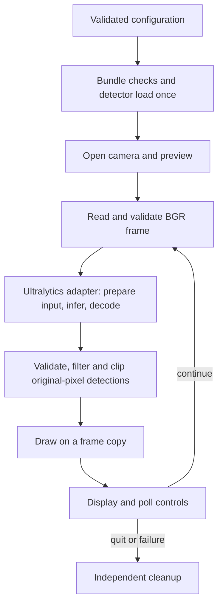

# Object Detection App: Theory and Code Explained

**Author: Shashank Jha**  
**Audience:** Students learning Python, computer vision, and applied machine learning  
**Source snapshot date:** 2026-10-09  
**Application version:** 0.1.0

## Instructions for generating the student PDF

Upload this Markdown file to ChatGPT and use the following request:

> Create a polished, comprehensive student PDF titled “Object Detection App: Theory and Code Explained”, with **Shashank Jha** as the author on the cover. Use this document as the primary source. Explain concepts before their code applications. Preserve the distinction between implemented behavior, general theory, and pending verification. Include a table of contents, numbered chapters, readable equations, worked examples, architecture and sequence diagrams, code explanations, a glossary, exercises, and answer guidance. Render diagrams into the PDF rather than leaving Mermaid markup visible. Keep code in a readable monospace font with sensible page breaks and no clipped lines. Explain important functions using the exact source appendix; label shortened or simplified examples explicitly. Place the full application source listings in an appendix, with filenames and page references. Use original teaching explanations and attribute official documentation through the reference links. Do not invent model accuracy, hardware results, custom training completion, or Windows validation. Do not describe all YOLO generations as using identical grid, anchor, objectness, or NMS mechanisms. Keep these PDF-generation instructions out of the student-facing PDF. If the available tools support PDF generation, create and visually check the PDF; otherwise provide the formatted notes without claiming a PDF was generated.

This file includes theory, explanations, project facts, and a complete source snapshot. The PDF can be generated from this file alone; it does not require access to the local repository. The appendix is a snapshot, so future code changes require a refreshed guide.

---

## 1. What students will learn

After studying these notes, students should be able to:

1. Distinguish classification, localization, detection, segmentation, and tracking.
2. Explain how an image becomes a tensor and how a detector produces boxes and class scores.
3. Calculate bounding-box conversions, Intersection over Union, precision, recall, and F1.
4. Explain confidence filtering, NMS, transfer learning, and dataset leakage.
5. Trace a webcam frame through this application's modules.
6. Explain configuration validation, model bundles, cleanup, and automated tests.
7. Run the app using a virtual environment on macOS or Windows.
8. Prepare a custom detection dataset and describe training, evaluation, export, and verification.
9. Interpret performance measurements without confusing inference speed with webcam FPS.

Prerequisites: Python functions, lists/dictionaries, loops, basic classes, and simple algebra. NumPy, tensors, neural networks, and evaluation metrics are introduced here.

## 2. What this app does—and its present status

The app opens one webcam and processes frames locally. For retained detections it draws a box, class name, and confidence score. It has quit controls and adjustable confidence. Model weights are loaded once at startup rather than once per frame.

The runnable baseline uses the official pretrained YOLO26n checkpoint and its ordered list of 80 COCO classes. Examples include person, cup, bottle, chair, laptop, keyboard, and book. The exact list is in the model bundle. A pretrained class vocabulary is a boundary: the app cannot reliably recognize every object someone places in front of the camera. Detecting a person category does not identify that person.

The project contains custom dataset validation, training, evaluation, export, and benchmark workflows. No representative custom dataset or quality-validated custom model has been supplied. A one-epoch synthetic training exercise checked workflow execution only; its zero metrics are not evidence of project accuracy.

Recorded verification from 2026-10-07:

| Evidence | Recorded result | Meaning |
| --- | --- | --- |
| Automated tests including model integration | 40 passed | Tested logic and selected actual-model paths |
| Public sample image | Five retained detections at confidence 0.35 | Example inference, not an accuracy study |
| Checkpoint CPU benchmark | Median 27.31 ms; p95 28.58 ms | Prediction plus output validation |
| ONNX CPU benchmark | Median 23.08 ms; p95 29.69 ms | Same short sample protocol |
| Export parity | Passed on an object scene and a blank image | Limited output-comparison evidence |
| Physical webcam attempt | macOS denied camera access | Live preview verification remains pending |
| Windows | Instructions provided; not verified | Do not claim Windows support has been tested |

Benchmark environment: Python 3.14.7, macOS 27.0.1, arm64 Apple M4, CPU, input size 640. Ten measured iterations followed three warm-up iterations. Neither benchmark includes camera capture or display. These are historical measurements, not universal speed guarantees or new measurements made on the snapshot date.

## 3. The computer-vision task

| Task | Question answered | Example output |
| --- | --- | --- |
| Classification | What category is present? | “cup” |
| Localization | Where is one target? | One box |
| Object detection | What objects are present and where? | Multiple boxes and categories |
| Segmentation | Which pixels belong to each region/object? | Pixel masks |
| Tracking | Which detection corresponds to the same object over time? | Persistent IDs |

Motion detection is different: consecutive-frame changes can indicate movement without recognizing an object. This object detection app can detect a stationary cup because it analyzes its visual appearance. It does not implement persistent tracking, segmentation, or identity recognition.

Imagine a frame containing two cups and one bottle. Detection should return three instances, even though there are only two category names. A class is a category; an instance is an individual occurrence.

## 4. Pixels, arrays, color, and tensors

A color frame is an array with shape `(height, width, channels)`. An OpenCV webcam frame normally uses BGR channel order and `uint8` values from 0 to 255.

For a 640 × 480 image:

- Array shape is `(480, 640, 3)`; height comes first.
- Pixel location uses `frame[y, x]`, not `frame[x, y]`.
- Raw storage is `480 × 640 × 3 = 921,600` bytes, approximately 0.88 MiB.
- The top-left image coordinate is `(0, 0)`; x increases rightward and y downward.

A neural network typically needs a batch/channel-first tensor such as `(1, 3, 640, 640)`, often with floating-point channels. A common normalization is `pixel / 255`, making 128 approximately 0.502. Exact layout, normalization, and color order belong to the selected model/runtime contract.

**Important implementation distinction:** The current app supplies a BGR NumPy frame to the Ultralytics high-level API. That API owns the necessary model preparation. Students must not manually convert/normalize/letterbox the image and then unknowingly ask the framework to perform those steps again.

## 5. Neural networks and detector intuition

A neural network learns parameters that turn input patterns into useful predictions. In image models, convolutions combine local pixel or feature neighborhoods with learned filters. Early features can represent edges or textures; later features combine evidence useful for object categories and positions. These are explanatory tendencies, not a rule that each neuron has one human-readable meaning.

A small convolution-style calculation illustrates the operation. For a patch:

```text
1 2
3 4
```

and an all-ones 2 × 2 filter, the sum of elementwise products is `1 + 2 + 3 + 4 = 10`. Real networks learn many filters and use multiple channels, strides, nonlinear activations, and other blocks. Deep-learning libraries commonly implement the operation convention called cross-correlation rather than mathematically flipping the filter.

A conceptual detector has:

- A feature extractor, often called a backbone.
- Feature combination across resolutions, often called a neck.
- A detection head producing localization and class evidence.

Small objects benefit from sufficiently detailed spatial features. Increasing image resolution may help preserve details but also increases compute and memory. Larger models may offer more capacity at greater cost. Neither guarantees better results on poorly labeled or unrepresentative data.

YOLO is a family of detectors that predicts localization and categories through a unified detection inference path. “You Only Look Once” does not mean one Python instruction or one mathematical layer. Historical grid/anchor explanations are not exact descriptions of every modern YOLO model. Internal heads, losses, assignment, and suppression behavior vary. This project's learning focus is the verified public interface and output contract; consult the pinned implementation for architecture-specific internals.

## 6. Bounding boxes and coordinate conversions

The app's decoded output uses `xyxy`:

\[
(x_1,y_1,x_2,y_2)
\]

These describe top-left and bottom-right corners in original-frame pixel coordinates. For geometric calculations:

\[
w=x_2-x_1,\quad h=y_2-y_1
\]

\[
c_x=(x_1+x_2)/2,\quad c_y=(y_1+y_2)/2
\]

YOLO text annotations use a class ID followed by normalized center and dimensions:

```text
class_id center_x center_y width height
```

For image width `W` and height `H`, divide x coordinates and width by `W`, and y coordinates and height by `H`.

**Worked example:** In a 640 × 480 image, a box `(160,120,320,240)` has center `(240,180)` and dimensions `(160,120)`. Its normalized center is `(0.375,0.375)` and normalized dimensions are `(0.25,0.25)`. If its dataset class ID is 0, the label is:

```text
0 0.375 0.375 0.25 0.25
```

The ID's meaning comes from that dataset/model class map. Class 0 in this teaching example need not mean class 0 in the pretrained COCO bundle.

The renderer works with pixel indices and clips to `[0, W-1]` and `[0, H-1]`. The geometric width convention above does not imply that the app should add one to widths for metric calculations.

## 7. Resizing and letterboxing

Directly stretching a rectangular image to a square changes its proportions. Letterboxing rescales while preserving aspect ratio and adds padding to reach the desired input shape.

For target side `S`:

\[
s=\min(S/W,S/H)
\]

Compute resized dimensions using rounding, then place the image inside a padded canvas. For 1280 × 720 mapped to 640 × 640, nominal scale is 0.5, resized dimensions are 640 × 360, and vertical padding totals 280 pixels: 140 above and below.

A box `(100,200,300,400)` in the original becomes `(50,240,150,340)` in that padded input. Inverse mapping subtracts padding and divides by scale:

\[
x=(x'-p_x)/s_x,\qquad y=(y'-p_y)/s_y
\]

The project's `Transform` stores separate exact x/y scales because integer-rounded resize dimensions can make them slightly different. `letterbox()` returns both the padded array and this metadata. Synthetic tests check that known boxes restore correctly for non-square images.

**Current runtime:** `letterbox()` is a tested helper for education/future raw adapters; it is not called before the current Ultralytics backend. The backend already restores boxes to original-frame coordinates. Applying the inverse mapping again would misalign them.

## 8. Confidence, IoU, and NMS

### Confidence

A confidence score ranks how strongly the model supports a detection. It is not a guaranteed percentage likelihood of correctness. At the default 0.35 operating threshold, the app's final filter rejects scores below 0.35. A valid row at exactly 0.35 passes that app filter; the backend may already have performed its own filtering.

Higher thresholds typically reduce the retained predictions and can reduce false alerts while missing more objects. Lower thresholds retain more candidates and can increase false positives. Select an operating setting using validation data and the intended application's tradeoff.

### Intersection over Union

IoU measures overlap:

\[
IoU(A,B)=\frac{Area(A\cap B)}{Area(A)+Area(B)-Area(A\cap B)}
\]

For boxes `(0,0,100,100)` and `(50,0,150,100)`, each area is 10,000 and the intersection is 5,000. Union is 15,000, giving IoU approximately 0.333. Identical nonzero boxes have IoU 1; disjoint boxes have IoU 0.

### Non-maximum suppression

When a model/runtime needs NMS, it can remove redundant overlapping predictions. A typical class-aware procedure selects the highest-scoring box, suppresses same-class overlapping candidates above its IoU threshold, and repeats. Two boxes with scores 0.90 and 0.70 and IoU 0.85 would commonly keep only the first at an NMS threshold of 0.7. Different-class boxes need not suppress one another under class-aware NMS.

Do not assume every YOLO inference path needs external NMS. Some heads are designed for end-to-end outputs; exported contracts also vary. In this app, Ultralytics owns required suppression. `decode_detections()` does not repeat NMS. The `iou` parameter is relevant when the selected backend uses it.

An IoU threshold used for suppression is different from the IoU rule used to match predictions during accuracy evaluation, even though both use the same overlap formula.

## 9. Training, transfer learning, and hyperparameters

Inference applies learned parameters; training updates them using labeled data. Starting from a pretrained checkpoint transfers existing visual features, then fine-tuning adapts the model to project classes.

A conceptual training iteration:

1. Read labeled examples and apply suitable augmentation.
2. Predict boxes and class evidence.
3. Compute model-specific localization/classification losses.
4. Backpropagate gradients through the network.
5. Let the optimizer update parameters.
6. Evaluate on independent validation examples without training on them.

The simplified gradient update is:

\[
\theta_{new}=\theta_{old}-\eta\nabla_\theta L
\]

Here `theta` represents parameters, `eta` is learning rate, and `L` is the loss. This illustrates gradient descent; optimizers such as AdamW use additional state and update rules. Do not present it as the exact optimizer implementation in this project's framework.

| Term | Meaning | Practical effect |
| --- | --- | --- |
| Epoch | One traversal of training data | More epochs allow more updates, but can overfit |
| Batch size | Examples processed together | Affects memory and optimization behavior |
| Learning rate | Update-size control | Poor values can destabilize or slow learning |
| Input resolution | Model training image dimensions | Detail/compute tradeoff |
| Seed | Controls supported random operations | Helps reproduction, not cross-device identity |
| Patience | Waiting policy for stopping | Interpreted by the selected framework |
| Augmentation | Label-consistent image variation | Can improve robustness when realistic |

Current `configs/train.yaml` proposes 50 epochs, batch 8, image size 640, CPU, seed 42, patience 10, workers 0. These are starting settings, not proven optimal values. Optimizer and augmentation defaults come from the pinned framework; the app does not explicitly configure every setting. Real training outputs record the effective framework settings as well as the supplied config.

Overfitting means training performance improves without comparable generalization. Underfitting means the model has not captured sufficient useful structure. Inspect errors, label quality, scenario coverage, model capacity, and train/validation behavior before blindly increasing training duration.

## 10. Dataset preparation and leakage

Collect permitted images representative of use: sizes, angles, backgrounds, lighting, occlusion, and empty scenes. Annotation quality matters: inconsistent boxes or missing objects teach conflicting signals.

This project requires corresponding labels in `labels/train`, `labels/val`, and `labels/test`, with images in matching `images/<split>` paths. An empty text file means an intentionally reviewed negative image. A missing file is rejected because it could mean annotation was forgotten.

Train data fits parameters. Validation data supports model/threshold choices. The final test split evaluates a frozen candidate. Splitting near-identical frames from one camera session randomly across these sets can make performance appear better than real generalization.

Example: 100 consecutive frames of the same bottle are not 100 independent environments. Group the session before splitting. `groups.json` maps relative image paths to source/session IDs; one group cannot span splits.

The validator checks parseable images, labels, finite geometry, class IDs, paired paths, duplicate boxes, class coverage, exact decoded-pixel duplicate images, and group overlap. Pixel hashing catches identical decoded images stored with different file encodings. It does not detect every near-duplicate, assess rights, or determine whether a box labels the correct object. Human review remains necessary.

The current validator expects instances of every listed class in each split. This is the project's policy, not a universal YOLO dataset requirement. Also, its directory layout is deliberately stricter than all layouts a framework might support.

An integrity audit may inspect test files/labels for corruption and leakage; that is different from repeatedly evaluating predictions on test data to choose the model. If test results drive further development, reserve new independent test data for the revised release.

## 11. Evaluating detection quality

A true positive requires a correct class and a suitable geometric match under the evaluation protocol. Predictions are matched to ground truth without counting multiple predictions as independent successes for the same instance. An unmatched prediction is a false positive; an unmatched ground-truth instance is a false negative.

\[
Precision=\frac{TP}{TP+FP},\qquad Recall=\frac{TP}{TP+FN}
\]

\[
F_1=\frac{2PR}{P+R}
\]

**Worked example:** Ten labeled objects, eight predictions, six correct matches. TP = 6, FP = 2, FN = 4. Precision = 0.75, recall = 0.60, and F1 is approximately 0.667. This is one operating point; it is not AP.

AP summarizes a class's precision-recall behavior across score thresholds under a specified matching/interpolation protocol. mAP averages across classes. `mAP@0.5` uses IoU 0.50; `mAP@0.5:0.95` averages the stated metric across thresholds 0.50, 0.55, …, 0.95 and classes. Exact evaluator rules matter. See the [official metrics guide](https://docs.ultralytics.com/guides/yolo-performance-metrics/).

Inspect per-class metrics and prediction examples. A strong average can hide a weak class. The runtime confidence threshold and AP evaluation are not identical measurements. The workflow uses the framework's validation routine; it does not manually integrate AP inside the webcam loop. Its report's precision/recall follow that framework's evaluation convention, not automatically the live app's 0.35 setting.

Accuracy percentages are often poorly defined for detection: there is no simple count of all “true-negative boxes”. Do not say mAP 0.80 means exactly 80% of arbitrary webcam detections are correct.

## 12. Application architecture



Responsibility boundaries:

| File | Responsibility | Why separate it? |
| --- | --- | --- |
| `main.py`, `__main__.py` | Launch, arguments, dispatch, exit codes | Keep startup approachable and explicit |
| `paths.py` | Project-root resolution | Editable/wheel installs locate external assets differently |
| `config.py` | Parse and validate settings | Reject invalid state before the loop |
| `contracts.py` | Error, detection and transform types | Establish common meanings |
| `camera.py` | Open/read/release webcam | Own one hardware resource |
| `preprocessing.py` | Frame validation and letterbox helper | Test geometry independently |
| `detector.py` | Bundle checks and detector interface | Keep app independent of artifact backend |
| `backends/ultralytics.py` | Current framework/runtime adapter | Contain backend assumptions |
| `postprocessing.py` | Decoded-output checks/filtering/clipping | Keep unsafe coordinates out of drawing |
| `renderer.py` | Overlay, display and controls | Keep GUI separate from inference |
| `controller.py` | Lifecycle and per-frame orchestration | Coordinate resources without merging all code |
| `timing.py` | Bounded aggregate measurements | Keep instrumentation understandable |
| `data.py` | Dataset audit | Catch data mistakes before training |
| `workflows.py` | Acquisition, training, evaluation, export and comparison | Keep expensive operations out of webcam startup |
| `scripts/manage.py` | Alternate guarded workflow launcher | Use the same CLI implementation |

## 13. Startup, configuration, and Python constructs

`main.py` delegates to the CLI; when launched without extra arguments, it appends `run`. The `if __name__ == "__main__"` guard runs entry code only when executing the file directly, not when importing it.

`parser()` creates subcommands. `execute()` dispatches to the chosen operation. Heavy work happens after argument parsing so help does not open cameras or load model weights. `main()` prints results and returns exit codes: 0 for success, 1 for controlled failure, and 130 for keyboard interruption.

`Config` is a frozen dataclass: its fields describe one startup configuration and accidental reassignment is blocked. `__post_init__()` validates it after construction. Checking `type(value) is int` deliberately rejects booleans, because Python otherwise treats `bool` as an `int` subclass. `math.isfinite()` rejects NaN/infinity that can defeat ordinary numeric assumptions.

`yaml.safe_load()` avoids arbitrary YAML object construction; it does not replace schema validation. Unknown setting names are rejected so a misspelled `confidence` does not silently take a default.

YAML bundle paths are relative to the config file; CLI paths are relative to the caller's working directory. `Path.resolve()` and explicit path ownership prevent a command launched from a different directory from choosing the wrong artifact accidentally.

`Detection` is a structured record of class ID, name, confidence and box. `Detector(Protocol)` expresses a structural interface: an object can meet it by providing the required methods/attributes without inheriting one large base class. Fake test components use that principle. Type hints document expectations; they do not automatically validate runtime values.

## 14. Camera and model-bundle explanation

`Camera.open()` creates `cv2.VideoCapture(index)` and checks `isOpened()`. `read()` checks the capture success flag; failed reads return `None`, while successful images pass `validate_frame()`. That validator expects a nonempty three-channel `uint8` array and bounds dimensions. Never use a failed frame's `.shape` or pass it into inference.

`close()` clears the stored capture reference and calls `release()`. Repeated cleanup is safe because a cleared reference is no longer released again. Camera access can fail because of OS permissions, another application, an incorrect index, or disconnected hardware.

A bundle combines weights and their interpretation. `read_bundle()` checks schema, adjacent local artifact name, extension/existence, checksum, class-map content, ownership declarations, coordinate convention, and input-size metadata before constructing the backend. The ONNX path also requires matching static input size and CPU in this implementation.

SHA-256 fingerprints file bytes. If weights change, the expected checksum should change. This can detect accidental modification against a trusted manifest, but a malicious party can modify both the weights and manifest. A checksum alone neither proves publisher authenticity nor makes an untrusted checkpoint safe to load.

## 15. Inference adapter explained

Read `UltralyticsBackend.predict()` in Appendix A alongside this explanation:

1. `model.predict(source=frame, ...)` passes one NumPy frame and explicit settings.
2. `rect=False` requests fixed-square input preparation appropriate to the configured size.
3. `agnostic_nms=False` selects class-aware suppression where applicable.
4. `save=False`, `save_txt=False`, and `show=False` leave media persistence and display out of the backend call.
5. `[0]` selects the result for the single supplied image.
6. Device synchronization supports meaningful timing when computation is asynchronous.
7. `check_names(result.names)` compares runtime metadata with the bundle.
8. `boxes.xyxy`, `boxes.conf`, and `boxes.cls` provide decoded boxes, scores and IDs.
9. `.cpu().numpy()` converts supported tensors into CPU arrays; `np.column_stack` combines them into `(N,6)` rows.
10. The function returns rows and backend stage timings, converted from milliseconds to seconds.

Boxes already belong to the original image; no second inverse transform is applied. Empty arrays with shape `(0,6)` are valid. A missing box output contract is an error, not silently equivalent to no detected objects.

`yolo_class()` configures project-local framework caches, offline mode, disabled automatic dependency installation, disabled framework sync, and ONNX telemetry-event disablement before constructing models. Explicit setup still uses its own requested network download. Treat these controls as implementation safeguards, not an assertion that every conceivable native-library path was formally network-audited.

## 16. Postprocessing explained with a concrete row

Suppose a frame is 100 × 80 and the adapter supplies:

```text
[-10, -5, 200, 90, 0.35, 0]
```

With `names = ("cup",)` and threshold 0.35:

- There are six finite numeric values and class ID 0 is valid.
- Score lies in `[0,1]` and is not below threshold.
- The box is ordered correctly but extends beyond the frame.
- Clipping yields `(0,0,99,79)`.
- Positive area remains, so a `Detection` record is returned.

`decode_detections()` rejects malformed shape, non-finite/non-numeric values, invalid class IDs/scores, and reversed coordinates. Valid boxes that collapse after clipping are discarded. An unknown class ID must not index into the class list unchecked. This function does not perform NMS.

Filtering is roughly linear in decoded candidate count. The app caps backend detections, limiting drawing work. These complexity statements describe application logic, not the internal cost of the neural network.

## 17. Renderer and controller explained

`Renderer.draw()` begins with `frame.copy()`. Annotations belong to the display copy, preserving the captured image. It draws boxes, class/score labels, object count, threshold, rolling FPS, and controls. Label placement is bounded near edges; repeated camera-free drawing does not open a window.

`show()` checks whether the existing window is closed before calling `imshow()`. This avoids recreating a window after native close. Some GUI backends raise while querying an already-destroyed window; `is_closed()` treats that as closure. Errors from initialization or actual display still reach the controller. `waitKey()` polls events/keyboard; without GUI event processing, a preview may stop responding.

`controller.run()` has injectable camera, renderer and detector arguments. Production defaults create real components; tests supply fakes.

Per valid frame:

```text
read → predict → validate detections → draw copy → show/poll → record times → apply controls
```

`None` reads increment a failure counter. With `read_retries=3`, the fourth consecutive failed read triggers exit: one failed attempt plus up to three retries. The counter resets after a valid frame. Controls remain polled during retries.

Quit keys are Q/q/Esc. Plus/equal raises confidence by 0.05; minus/underscore lowers it. Rounding and clamping keep the value in `[0,1]`. The changed threshold affects the next prediction and is not saved to config automatically.

A `finally` block attempts camera, renderer, and detector cleanup independently. If display cleanup fails, camera release still gets its own attempt. Cleanup errors are logged minimally rather than masking the original operational failure. Keyboard interruption also runs the `finally` block.

## 18. Timings, responsiveness, and memory

`perf_counter()` measures elapsed durations using a suitable monotonic high-resolution clock. Clock readings are differences, not wall-calendar timestamps.

For a synchronous loop:

\[
Processed\ FPS=\frac{Number\ of\ samples}{Sum\ of\ total\ durations}
\]

If ten measured frames each take 0.05 seconds, processed FPS is `10 / 0.5 = 20`. This is not automatically the camera's capture rate, display refresh rate, or age of the image shown.

`Timings` uses `deque(maxlen=300)`. Old samples are evicted, so instrumentation storage does not grow with total session duration. Median describes a typical sample; p95 describes a tail boundary estimated from the measured sample. A ten-sample p95 is preliminary, not a reliable characterization of a long session.

Backend preprocessing/inference/postprocessing timings are subdivisions of the overall backend duration. Adding those subdivisions to the backend duration would double-count. Full-loop time also includes capture, validation, rendering, display and Python overhead.

Warm-up can initialize caches and execution machinery. Benchmark reports state its count and measured boundaries. `benchmark()` reads supplied images and times prediction plus validation, excluding decode/camera/display.

One frame is processed at a time. Application frame memory depends on resolution and the finite number of working copies; model/workspace memory is additional. A future capture worker should use a bounded latest-frame slot rather than accumulating an unlimited queue of increasingly stale frames. Such a worker is a possible future optimization, not implemented behavior.

## 19. Data/model workflows explained

| CLI operation | Main behavior | Learning point |
| --- | --- | --- |
| `setup-model` | Downloads a fixed official asset and packages it | Acquisition is explicit, not hidden in startup |
| `package-model` | Copies a trusted local artifact and writes metadata | Weights require provenance and interpretation |
| `inspect-model` | Verifies/readprints bundle metadata | Know the exact classes/settings |
| `validate-data` | Audits labels, duplicates and group splits | Data bugs invalidate later measurements |
| `train` | Audits data, trains a checkpoint, packages best weights | Fine-tuning is reproducible workflow work |
| `evaluate` | Calls framework validation and records metrics | Evaluation is separate from visual demonstration |
| `export` | Exports a copied checkpoint to static ONNX | Preserve original training artifact |
| `verify-export` | Compares decoded outputs on identical images | Export success is not equivalence proof |
| `benchmark` | Measures warm/steady-state prediction timing | State exact timing boundaries |

`resolved_dataset()` makes the dataset root absolute before passing YAML to the framework. Otherwise the framework's dataset cache root might interpret a relative path differently from the application's audit.

Training validates supported config keys and preserves new run directories. Its manifest records dataset audit, source bundle, supplied settings, environment and completion status. The selected checkpoint is packaged with the class map learned for that dataset; it need not retain all pretrained classes.

`evaluate` supports validation and final test modes. The CLI requires `--final-test` when selecting test data, reminding the operator to freeze the candidate first. It cannot prove that a human has kept that test split independent.

## 20. Export and output comparison

A `.pt` checkpoint belongs to a framework workflow; ONNX represents a computation graph for compatible runtimes. Exporting does not improve the model by definition and may change execution behavior. Static input shapes must match the deployment bundle. Precision/opset/runtime settings are relevant to compatibility and reproducibility.

This implementation exports a copy, preserving original weights, using FP32/static input and `simplify=False`. The recorded baseline export used opset 18. Application code uses the documented framework export API; framework internals may choose their own implementation path.

`compare_detections()` sorts checkpoint detections by confidence. For each one it chooses the remaining same-class export detection with highest IoU, removes that match, and checks score/coordinate differences. It flags unmatched checkpoint detections and leftover export detections.

Default comparison tolerances are 0.02 score units and 2 original-image pixels. Matching is greedy, not an optimal global assignment. With dense overlapping objects, the procedure can require investigation or a stronger matching policy. Passing on a blank image alone is weak evidence because neither runtime may return a detection. Use diverse object scenes too, then compare dataset metrics and actual webcam behavior.

## 21. Tests and engineering reasoning

| Test file | What it teaches |
| --- | --- |
| `test_geometry.py` | Round-trip transforms, shape/dtype checks, clipping, threshold boundaries, invalid outputs |
| `test_config_bundle.py` | Boundary validation, config path ownership, integrity checks, matching and bounded timings |
| `test_lifecycle.py` | Injectable fakes, cleanup after different failures, threshold control without reload |
| `test_data.py` | Independent groups, duplicates, invalid/missing labels |
| `test_renderer.py` | Native closure should not display/recreate a closed window |
| `test_model_integration.py` | Actual local runtimes, input immutability and sample parity |
| `conftest.py` | Opt-in artifact-dependent tests |

A unit test isolates a small contract. Integration tests connect real components. A hardware smoke check exercises actual camera/GUI behavior. A mock cannot establish that macOS permission has been granted or that a Windows window behaves correctly.

The optional real-model tests deny Python socket connections. That checks tested Python-level network paths; it is not a complete audit of every native networking mechanism. No inference accuracy is inferred from a geometry test.

Passing tests means the specified cases passed under that environment. It does not guarantee every scene, runtime, or device. Historical recorded count is 40; rerun to report a current result after changes.

## 22. Running the project in a virtual environment

A venv isolates project Python dependencies. Creating it uses the installed interpreter; subsequent commands select the venv interpreter explicitly. Activation is optional. Do not copy a macOS venv to Windows.

Existing macOS installation, from `object-detection-app`:

```bash
venv/bin/python main.py
venv/bin/python -m pytest -q
venv/bin/python -m object_detection_app inspect-model
```

Fresh macOS environment:

```bash
python3.14 -m venv venv
venv/bin/python -m pip install --upgrade pip
venv/bin/python -m pip install -r requirements.lock.txt
venv/bin/python -m pip install --no-build-isolation -e .
venv/bin/python -m object_detection_app setup-model
venv/bin/python main.py
```

Fresh Windows PowerShell environment:

```powershell
py -3.14 -m venv venv
.\venv\Scripts\python.exe -m pip install --upgrade pip
.\venv\Scripts\python.exe -m pip install setuptools==84.0.0
.\venv\Scripts\python.exe -m pip install --no-build-isolation -e ".[dev,export]"
.\venv\Scripts\python.exe -m object_detection_app setup-model
.\venv\Scripts\python.exe main.py
.\venv\Scripts\python.exe -m pytest -q
```

Windows resolves platform-appropriate transitive packages; the provided full lock records the macOS installation. Windows instructions are unverified. In Command Prompt, `venv\Scripts\python.exe` works without the leading `.\`. For the remaining CLI examples, substitute this interpreter prefix and retain the arguments. Quote paths containing spaces.

OS permission is separate from Python installation. On macOS, check Privacy & Security → Camera for the hosting app. On Windows 11, check Privacy & security → Camera and desktop-app camera access. Do not bypass permissions. Close competing camera apps, verify the device, and use the correct camera index.

## 23. Practical exercises

### Lab A: Image shape and storage

Create a synthetic `(240,320,3)` uint8 array. Print its shape/dtype/nbytes. Predict the byte count before running. Change one BGR pixel and inspect it by `[y,x]`.

Expected storage: `240 × 320 × 3 = 230,400` bytes. No webcam is necessary.

### Lab B: Box-coordinate round trip

Use `letterbox()` with a 301 × 97 image. Map a known original box into its padded canvas using the returned scales/padding, then call `Transform.restore()`. Compare with a small tolerance. Explain why nominal scale alone may differ after rounding.

### Lab C: Confidence and invalid outputs

Pass three valid `(N,6)` rows with scores 0.34, 0.35, and 0.90 into `decode_detections()` at 0.35. Then try NaN, reversed corners, and an unknown class ID. Explain why a rejected malformed output differs from a normal empty result.

Expected app filtering: 0.35 and 0.90 pass if geometry is valid. Corrupt values raise an operational error.

### Lab D: Dataset leakage

Use tiny permitted synthetic images in each split with matching labels and source groups. Audit them. Move one group ID across splits and rerun. Repeat with identical decoded pixels saved in two image files.

Expected: overlap/duplicate audit failures. Restore independence before training. This checks integrity, not meaningful generalization.

### Lab E: Lifecycle testing

Read the fake camera, detector, and renderer tests. Make a fake detector fail on the second frame and assert cleanup still happens. Do not use a real camera just to test exception flow.

### Lab F: Actual-model export comparison

Provision the baseline checkpoint and export it into a fresh directory. Compare a permitted object scene plus an empty image. Record classes, score/box tolerances, settings, and unmatched predictions. Do not adjust tolerances repeatedly just to make a failing result pass without explanation.

### Lab G: Webcam observations

After OS permission is granted, try a supported object at different distances and lighting. Adjust confidence and observe the retained boxes. Test quit controls and repeated starts. Record qualitative observations without saving personal footage or presenting them as dataset mAP.

### Lab H: Timing report

Benchmark a permitted image with three warm-ups and twenty measured iterations. State hardware, versions, shape, and boundaries. Compare median/p95 and explain why the reciprocal of model latency is not guaranteed live FPS.

## 24. Review questions and answer guidance

1. **Why is detecting a cup different from recognizing motion?** Detection uses learned appearance/category evidence; motion detection compares changes over time.
2. **Can the baseline detect any classroom object?** No; its class vocabulary and data coverage limit recognition.
3. **Why is `(480,640,3)` a 640-pixel-wide frame?** Array order is height, width, channels.
4. **Why do coordinates use `frame[y,x]`?** The first array axis is rows/height.
5. **Why is letterboxing useful?** It preserves proportions while fitting a target canvas.
6. **Should we call this project's letterbox helper before the current adapter?** No; framework preprocessing already owns that step.
7. **What does IoU measure?** Spatial overlap relative to union, not confidence.
8. **Does a score of 0.9 guarantee correctness?** No; score interpretation and calibration matter.
9. **Is raising confidence always better?** No; it changes the false-alert/missed-object tradeoff.
10. **Why not run NMS in `decode_detections()`?** The backend already owns required suppression.
11. **What are TP/FP/FN when there are five targets, four predictions and three correct matches?** TP=3, FP=1, FN=2; precision=0.75 and recall=0.60.
12. **Why can neighboring video frames cause leakage?** They share scene/object conditions that make splits insufficiently independent.
13. **Does an empty label mean a missing annotation file?** No; here it explicitly means reviewed negative imagery.
14. **Is low training loss enough?** No; validation generalization and later independent evaluation matter.
15. **Why load weights once?** Repeated loading wastes time/memory and disrupts responsiveness.
16. **Why use a display copy?** Drawing should not alter the captured input or later comparison assumptions.
17. **Why use `finally`?** Resource cleanup must happen on normal and exceptional exits.
18. **What does a checksum prove?** File identity relative to a trusted expected value, not authenticity by itself.
19. **Is model conversion success enough for release?** No; verify outputs, quality, speed and integration.
20. **Why are Windows instructions not proof of Windows support?** Execution and hardware behavior still need testing on that target.
21. **Why can 40 passing tests coexist with unverified webcam behavior?** Many tests intentionally use fakes or still images rather than actual hardware.
22. **Why do backend timings not get added to their own subdivisions?** That would count the same work twice.
23. **What does the synthetic training smoke test establish?** Workflow execution and artifact production, not real object-detection quality.
24. **Does changing the class map add a new detectable object?** No; changing names without appropriate weights merely mislabels IDs.

## 25. Common mistakes and troubleshooting

| Symptom or misconception | Likely issue | What to check |
| --- | --- | --- |
| Wrong colors | BGR/RGB mismatch or double conversion | Backend's documented input contract |
| Offset/stretched boxes | Incorrect or duplicated geometry restoration | Scale, padding and original-coordinate ownership |
| Duplicate suppression unexpectedly removes instances | NMS repeated or wrong class policy | One suppression owner and selected backend semantics |
| Camera fails before preview | Permission/index/device conflict | OS settings and camera availability |
| GUI does not open | Headless/conflicting OpenCV or non-desktop session | GUI-enabled installation and environment |
| Class names are incorrect | Weights/class map mismatch | Exact matching model bundle |
| Missing model causes download on startup | Hidden acquisition design | Use explicit setup, existing local bundle |
| Excellent validation, poor live behavior | Leakage/domain mismatch/coverage gaps | Grouped splits and representative scenes |
| Export runs but differs | Shape/precision/output/runtime mismatch | Parity report and artifact metadata |
| Memory grows throughout session | Retained images or unbounded queues/history | Bounded storage and object ownership |
| High model FPS but slow preview | Capture/display/other stages excluded | Full-loop timing and frame age |
| Test results improve after repeated tuning | Test contamination | Freeze selections and reserve new independent data |

## 26. Privacy, responsible use, and release readiness

Default webcam operation keeps frames in memory and does not record/upload them. Explicit training and evaluation workflows can create dataset-derived artifacts and plots; handle those according to their data rights and privacy needs. Use synthetic or permitted non-sensitive images for exercises.

Trust model sources: checkpoints can require code-bearing deserialization. Do not treat arbitrary weights as safe because a filename ends in `.pt`. Pin tested versions, keep artifact provenance, and avoid disabling safeguards to load unknown models.

Before a real release, confirm classes/use scenario and acceptance criteria, audit independent data, select model/thresholds on validation, run final evaluation, verify export quality, test actual camera/platform behavior, review applicable terms, and assign a maintainer. The project currently remains a development build with pending gates.

## 27. Glossary

| Term | Definition |
| --- | --- |
| Annotation | Ground-truth category/geometry supplied for learning or evaluation |
| Backbone | Feature-extraction portion of a model |
| Batch | Examples processed together |
| Bounding box | Rectangular localization of an instance |
| Checkpoint | Saved model parameters and relevant framework state |
| Class map | Ordered mapping from numeric IDs to category names |
| Confidence | Model detection score, not guaranteed correctness |
| Epoch | A traversal of training examples |
| Fine-tuning | Adapting pretrained parameters with task data |
| Ground truth | Reference labels used by a defined evaluation protocol |
| Inference | Applying a trained model |
| IoU | Intersection area divided by union area |
| Leakage | Information overlap that undermines independent evaluation |
| Letterbox | Aspect-preserving resize plus padding |
| NMS | A method for suppressing redundant overlapping candidates |
| ONNX | Interchange graph representation for compatible execution tools |
| Precision | Correct detections as a fraction of predictions |
| Recall | Matched ground-truth instances as a fraction of target instances |
| Tensor | A multidimensional numeric array used in computation |
| Validation | Independent data used during model/setting selection |
| venv | Project-specific Python environment |

## 28. Sources and further study

Primary project sources: architecture PDF, development plan, README, code/configs and verification reports. The exact local source snapshot follows in Appendix A; selected tests follow in Appendix B.

Official references for checking framework-specific behavior:

- [Ultralytics prediction API](https://docs.ultralytics.com/modes/predict/).
- [Ultralytics training workflow](https://docs.ultralytics.com/modes/train/).
- [Ultralytics detection datasets](https://docs.ultralytics.com/datasets/detect/).
- [Ultralytics model export](https://docs.ultralytics.com/modes/export/).
- [Ultralytics evaluation metrics](https://docs.ultralytics.com/guides/yolo-performance-metrics/).
- [Ultralytics YOLO26 model documentation](https://docs.ultralytics.com/models/yolo26/).
- [Python virtual environments](https://docs.python.org/3.14/library/venv.html).
- [OpenCV Python package guidance](https://pypi.org/project/opencv-python/).

Online documentation can evolve beyond the pinned project. Use the appendix and environment versions when explaining what this snapshot actually does. Additional facts from updated references should be labeled as updates rather than silently substituted into the implementation explanation.

---

## Appendix A. Exact application and configuration source

Listings are copied verbatim from the local project on 2026-10-09. They are executable project source, not pseudocode. The package modules work together; a listing is not necessarily a standalone script. Weights, datasets, caches, personal paths, and generated artifacts are not included.

### A. main.py

```python
"""Convenience launcher: `venv/bin/python main.py` starts the webcam preview."""

import sys

from object_detection_app.__main__ import main

if __name__ == "__main__":
    if len(sys.argv) == 1:
        sys.argv.append("run")
    raise SystemExit(main())
```

### A. scripts/manage.py

```python
"""Run explicit workflows with `venv/bin/python scripts/manage.py <command>`."""

from object_detection_app.__main__ import main

if __name__ == "__main__":
    raise SystemExit(main())
```

### A. pyproject.toml

```toml
[build-system]
requires = ["setuptools==84.0.0"]
build-backend = "setuptools.build_meta"

[project]
name = "object-detection-app"
version = "0.1.0"
description = "Local webcam object detection with versioned YOLO model bundles"
requires-python = ">=3.14"
dependencies = ["ultralytics==8.4.174", "opencv-python==5.0.0.93", "numpy==2.5.3", "PyYAML==6.0.3"]

[project.optional-dependencies]
dev = ["pytest==9.1.1", "ruff==0.16.10", "build==1.6.1"]
export = ["onnx==1.23.2", "onnxruntime==1.30.0"]

[project.scripts]
object-detection = "object_detection_app.__main__:main"

[tool.setuptools.packages.find]
where = ["src"]

[tool.pytest.ini_options]
testpaths = ["tests"]
filterwarnings = ["error::DeprecationWarning:object_detection_app.*"]
markers = ["model: requires local checkpoint and ONNX model bundles"]

[tool.ruff]
target-version = "py314"
line-length = 100

[tool.ruff.lint]
select = ["E", "F", "I", "UP", "B"]
```

### A. configs/app.yaml

```yaml
# Paths are relative to this configuration file, not the shell's current directory.
bundle: ../models/yolo26n/bundle.json
camera: 0
device: cpu
input_size: 640
confidence: 0.35
iou: 0.7
max_detections: 100
read_retries: 3
window_title: Object Detection App
```

### A. configs/train.yaml

```yaml
# Starting values only: select using your dataset and validation evidence.
epochs: 50
batch: 8
imgsz: 640
device: cpu
seed: 42
patience: 10
workers: 0
```

### A. configs/dataset.example.yaml

```yaml
# Replace names and create independently grouped, annotated splits before training.
path: ../data/custom-v1
train: images/train
val: images/val
test: images/test
names:
  0: replace_with_your_class
```

### A. src/object_detection_app/__init__.py

```python
"""Local object detection. Importing this package never opens a camera or loads weights."""

__version__ = "0.1.0"
```

### A. src/object_detection_app/__main__.py

```python
"""CLI entry point. Help is side-effect free; all artifact workflows are explicit."""

import argparse
import json
import logging
from dataclasses import replace
from pathlib import Path

from .contracts import AppError
from .paths import PROJECT_ROOT

ROOT = PROJECT_ROOT


def parser() -> argparse.ArgumentParser:
    cli = argparse.ArgumentParser(description="Local webcam object detection and model workflows")
    sub = cli.add_subparsers(dest="command", required=True)
    for name in ("run", "benchmark", "verify-export"):
        cmd = sub.add_parser(name)
        cmd.add_argument("--config", type=Path, default=ROOT / "configs/app.yaml")
        cmd.add_argument("--bundle", type=lambda s: Path(s).resolve())
        cmd.add_argument("--device")
        cmd.add_argument("--camera", type=int)
        cmd.add_argument("--confidence", type=float)
        cmd.add_argument("--input-size", type=int)
        if name == "run":
            cmd.add_argument("--max-frames", type=int, help="Optional bounded webcam smoke run")
        else:
            cmd.add_argument("--images", type=Path, nargs="+", required=True)
            cmd.add_argument("--output", type=Path, required=True)
        if name == "benchmark":
            cmd.add_argument("--warmup", type=int, default=3)
            cmd.add_argument("--iterations", type=int, default=20)
        if name == "verify-export":
            cmd.add_argument("--export-bundle", type=Path, required=True)
            cmd.add_argument("--score-tolerance", type=float, default=0.02)
            cmd.add_argument("--box-tolerance", type=float, default=2.0)
    setup = sub.add_parser("setup-model", help="Explicitly download official YOLO26n baseline")
    setup.add_argument("--output", type=Path, default=ROOT / "models/yolo26n")
    package = sub.add_parser("package-model", help="Bundle a trusted local model and provenance")
    package.add_argument("--artifact", type=Path, required=True)
    package.add_argument("--output", type=Path, required=True)
    package.add_argument("--source", required=True, help="Documented acquisition/training source")
    package.add_argument("--input-size", type=int, default=640)
    inspect = sub.add_parser("inspect-model")
    inspect.add_argument("--bundle", type=Path, default=ROOT / "models/yolo26n/bundle.json")
    for name in ("validate-data", "train", "evaluate"):
        cmd = sub.add_parser(name)
        cmd.add_argument("--data", type=Path, required=True)
        cmd.add_argument("--groups", type=Path, required=True)
        cmd.add_argument("--output", type=Path, required=True)
        if name != "validate-data":
            cmd.add_argument("--bundle", type=Path, required=True)
        if name == "train":
            cmd.add_argument("--train-config", type=Path, default=ROOT / "configs/train.yaml")
        if name == "evaluate":
            cmd.add_argument("--split", choices=("val", "test"), default="val")
            cmd.add_argument("--device", default="cpu")
            cmd.add_argument(
                "--final-test",
                action="store_true",
                help="Confirm frozen candidate before exposing the test split",
            )
    export = sub.add_parser("export")
    export.add_argument("--bundle", type=Path, required=True)
    export.add_argument("--output", type=Path, required=True)
    return cli


def execute(args):
    # Heavy libraries are imported after parsing, so --help needs no camera/model work.
    from . import workflows
    from .config import load_config
    from .detector import read_bundle

    if args.command in ("run", "benchmark", "verify-export"):
        config = load_config(
            args.config,
            {
                k: getattr(args, k)
                for k in (
                    "bundle",
                    "device",
                    "camera",
                    "confidence",
                    "input_size",
                )
            },
        )
        if args.command == "run":
            from .controller import run

            if args.max_frames is not None and args.max_frames < 1:
                raise AppError("max-frames must be positive.")
            return run(config, max_frames=args.max_frames)
        if args.command == "benchmark":
            report = workflows.benchmark(config, args.images, args.warmup, args.iterations)
        else:
            _, _, metadata = read_bundle(args.export_bundle)
            exported = replace(
                config,
                bundle=args.export_bundle.resolve(),
                input_size=metadata["input_size"],
                device="cpu",
            )
            if config.input_size != exported.input_size or config.device != "cpu":
                raise AppError("Compare checkpoint/export with matching input size on CPU.")
            report = workflows.verify_export(
                config, exported, args.images, args.score_tolerance, args.box_tolerance
            )
        workflows.write_json(args.output, report)
        if report.get("passed") is False:
            raise AppError("Export parity failed; inspect the written comparison report.")
        return report
    if args.command == "setup-model":
        return {"bundle": str(workflows.setup_model(args.output))}
    if args.command == "package-model":
        # Validate input_size with the same runtime rules before writing metadata.
        from .config import Config

        Config(bundle=Path("unused"), input_size=args.input_size)
        return {
            "bundle": str(
                workflows.package_model(
                    args.artifact,
                    args.output,
                    {"source": args.source},
                    args.input_size,
                )
            )
        }
    if args.command == "inspect-model":
        _, _, metadata = read_bundle(args.bundle)
        return metadata
    if args.command == "validate-data":
        from .data import validate_dataset

        report = validate_dataset(args.data, args.groups)
        workflows.write_json(args.output, report)
        return report
    if args.command == "train":
        return workflows.train(args.bundle, args.data, args.train_config, args.groups, args.output)
    if args.command == "evaluate":
        if args.split == "test" and not args.final_test:
            raise AppError(
                "Freeze model/settings first, then pass --final-test for held-out evaluation."
            )
        report = workflows.evaluate(
            args.bundle, args.data, args.groups, args.split, args.device, args.output
        )
        workflows.write_json(args.output / "metrics.json", report)
        return report
    if args.command == "export":
        return {"bundle": str(workflows.export_model(args.bundle, args.output))}
    raise AppError("Unsupported command.")


def main() -> int:
    args = parser().parse_args()
    logging.basicConfig(level=logging.INFO, format="%(levelname)s: %(message)s")
    try:
        print(json.dumps(execute(args), indent=2, allow_nan=False))
        return 0
    except KeyboardInterrupt:
        print("Stopped.")
        return 130
    except AppError as exc:
        logging.error("%s", exc)
        return 1
    except (OSError, ValueError) as exc:
        logging.error(
            "Cannot complete operation (%s). Check local files and settings.", type(exc).__name__
        )
        return 1
    except Exception as exc:
        # Do not print library exceptions that might include frame data or credentials.
        logging.error(
            "Operation failed (%s). Check compatible dependencies and artifact metadata.",
            type(exc).__name__,
        )
        return 1


if __name__ == "__main__":
    raise SystemExit(main())
```

### A. src/object_detection_app/backends/__init__.py

```python
"""Runtime implementations selected through the detector interface."""
```

### A. src/object_detection_app/backends/ultralytics.py

```python
"""Use the documented high-level API for both checkpoints and supported ONNX exports."""

import os
from importlib.util import find_spec
from pathlib import Path

import numpy as np

from ..contracts import AppError
from ..paths import PROJECT_ROOT


def yolo_class():
    # Disable runtime dependency installation and telemetry before importing the framework.
    # Keep framework/cache files in the project rather than global user directories.
    cache = PROJECT_ROOT / ".cache"
    (cache / "ultralytics").mkdir(parents=True, exist_ok=True)
    (cache / "matplotlib").mkdir(parents=True, exist_ok=True)
    os.environ["YOLO_CONFIG_DIR"] = str(cache / "ultralytics")
    os.environ["YOLO_AUTOINSTALL"] = "false"
    os.environ["YOLO_OFFLINE"] = "true"
    os.environ["MPLCONFIGDIR"] = str(cache / "matplotlib")
    if find_spec("onnxruntime") is not None:
        import onnxruntime

        onnxruntime.disable_telemetry_events()
    from ultralytics import YOLO, settings

    settings.update({"sync": False})
    return YOLO


def synchronize(device: str) -> None:
    import torch

    if device == "mps":
        torch.mps.synchronize()
    elif device != "cpu" and torch.cuda.is_available():
        torch.cuda.synchronize()


class UltralyticsBackend:
    def __init__(self, artifact: Path, names: tuple[str, ...], config):
        self.config = config
        self.names = names
        try:
            self.model = yolo_class()(str(artifact), task="detect")
        except Exception as exc:
            raise AppError(
                "Cannot load model. Check artifact integrity and runtime compatibility."
            ) from exc
        # ONNX metadata is initialized lazily; compare names after every prediction as well.
        if artifact.suffix == ".pt":
            self.check_names(self.model.names)

    def check_names(self, raw_names) -> None:
        if isinstance(raw_names, dict):
            if set(raw_names) != set(range(len(raw_names))):
                raise AppError("Model class IDs must be contiguous from zero.")
            actual = tuple(raw_names[i] for i in range(len(raw_names)))
        else:
            actual = tuple(raw_names)
        if actual != self.names:
            raise AppError("Model class map does not match the bundle. Use matching metadata.")

    def predict(self, frame, confidence: float) -> tuple[np.ndarray, dict[str, float]]:
        try:
            result = self.model.predict(
                source=frame,
                device=self.config.device,
                imgsz=self.config.input_size,
                conf=confidence,
                iou=self.config.iou,
                max_det=self.config.max_detections,
                rect=False,
                agnostic_nms=False,
                save=False,
                save_txt=False,
                show=False,
                verbose=False,
                stream=False,
            )[0]
            synchronize(self.config.device)
            self.check_names(result.names)
            boxes = result.boxes
            if boxes is None:
                raise AppError("Detection model returned no box output contract.")
            # xyxy is already in original-frame coordinates, and the API owns NMS (if needed).
            rows = np.column_stack(
                (
                    boxes.xyxy.cpu().numpy(),
                    boxes.conf.cpu().numpy(),
                    boxes.cls.cpu().numpy(),
                )
            )
            speed = {
                k: float(result.speed[k]) / 1000
                for k in (
                    "preprocess",
                    "inference",
                    "postprocess",
                )
            }
            return rows, speed
        except AppError:
            raise
        except Exception as exc:
            raise AppError(
                "Model inference failed. Check device, input size, and runtime."
            ) from exc

    def close(self) -> None:
        self.model = None
```

### A. src/object_detection_app/camera.py

```python
"""Own the webcam resource and never return an unchecked frame."""

import cv2

from .contracts import AppError
from .preprocessing import validate_frame


class Camera:
    def __init__(self, index: int):
        self.index = index
        self.capture = None

    def open(self) -> None:
        self.capture = cv2.VideoCapture(self.index)
        if not self.capture.isOpened():
            self.close()
            raise AppError("Cannot open camera. Check permission, camera index, and other apps.")

    def read(self):
        if self.capture is None:
            raise AppError("Camera has not been opened.")
        ok, frame = self.capture.read()
        if not ok:
            return None
        return validate_frame(frame)

    def close(self) -> None:
        capture, self.capture = self.capture, None
        if capture is not None:
            capture.release()
```

### A. src/object_detection_app/config.py

```python
"""Strict startup configuration with predictable path resolution."""

import math
from dataclasses import dataclass, fields
from pathlib import Path

import yaml

from .contracts import AppError


@dataclass(frozen=True)
class Config:
    bundle: Path
    camera: int = 0
    device: str = "cpu"
    input_size: int = 640
    confidence: float = 0.35
    iou: float = 0.7
    max_detections: int = 100
    read_retries: int = 3
    window_title: str = "Object Detection App"

    def __post_init__(self) -> None:
        for name, low, high in (
            ("camera", 0, 64),
            ("input_size", 32, 4096),
            ("max_detections", 1, 1000),
            ("read_retries", 0, 100),
        ):
            value = getattr(self, name)
            if type(value) is not int or not low <= value <= high:
                raise AppError(f"{name} must be an integer between {low} and {high}.")
        if self.input_size % 32:
            raise AppError("input_size must be a multiple of 32.")
        for name in ("confidence", "iou"):
            value = getattr(self, name)
            if type(value) not in (int, float) or not math.isfinite(value) or not 0 <= value <= 1:
                raise AppError(f"{name} must be finite and between 0 and 1.")
        if not isinstance(self.device, str) or not self.device.strip():
            raise AppError("device must be a nonempty runtime device string.")
        if not isinstance(self.window_title, str) or not 1 <= len(self.window_title) <= 80:
            raise AppError("window_title must contain 1 to 80 characters.")
        if not isinstance(self.bundle, Path):
            raise AppError("bundle must be a local path.")


def load_config(path: Path, overrides: dict | None = None) -> Config:
    try:
        raw = yaml.safe_load(path.read_text())
    except (OSError, yaml.YAMLError) as exc:
        raise AppError("Cannot read configuration; check the file and YAML syntax.") from exc
    if not isinstance(raw, dict) or set(raw) - {f.name for f in fields(Config)}:
        raise AppError("Configuration must be a mapping containing only supported settings.")
    raw = dict(raw)
    bundle = raw.get("bundle")
    if not isinstance(bundle, str) or not bundle or "://" in bundle:
        raise AppError("Configuration requires a local model bundle path.")
    raw["bundle"] = (path.resolve().parent / bundle).resolve()
    # CLI paths are relative to the shell, whereas YAML paths belong to the YAML file.
    raw.update({k: v for k, v in (overrides or {}).items() if v is not None})
    return Config(**raw)
```

### A. src/object_detection_app/contracts.py

```python
"""Small shared contracts keep camera, runtime, geometry, and UI independent."""

from dataclasses import dataclass


class AppError(Exception):
    """An operational failure suitable for a concise user-facing message."""


@dataclass(frozen=True)
class Detection:
    class_id: int
    name: str
    confidence: float
    xyxy: tuple[float, float, float, float]


@dataclass(frozen=True)
class Transform:
    original_width: int
    original_height: int
    scale_x: float
    scale_y: float
    pad_x: int
    pad_y: int

    def restore(self, box: tuple[float, float, float, float]) -> tuple[float, ...]:
        x1, y1, x2, y2 = box
        return (
            (x1 - self.pad_x) / self.scale_x,
            (y1 - self.pad_y) / self.scale_y,
            (x2 - self.pad_x) / self.scale_x,
            (y2 - self.pad_y) / self.scale_y,
        )
```

### A. src/object_detection_app/controller.py

```python
"""A bounded synchronous pipeline with injectable resources for camera-free tests."""

import logging
from time import perf_counter

import cv2

from .camera import Camera
from .contracts import AppError
from .detector import load_detector
from .postprocessing import decode_detections
from .renderer import Renderer
from .timing import Timings

logger = logging.getLogger(__name__)


def run(config, *, camera=None, renderer=None, detector=None, max_frames=None) -> dict:
    camera = camera if camera is not None else Camera(config.camera)
    renderer = renderer if renderer is not None else Renderer(config.window_title)
    timings = Timings()
    confidence, failures, processed = config.confidence, 0, 0
    try:
        detector = detector if detector is not None else load_detector(config)
        camera.open()
        renderer.open()
        while max_frames is None or processed < max_frames:
            start = perf_counter()
            frame = camera.read()
            captured = perf_counter()
            if frame is None:
                failures += 1
                if failures > config.read_retries:
                    raise AppError("Camera stopped returning frames. Reconnect it and restart.")
                # Continue polling during bounded retries, so quit remains responsive.
                if renderer.poll() in (ord("q"), ord("Q"), 27):
                    break
                continue
            failures = 0
            rows, stages = detector.predict(frame, confidence)
            predicted = perf_counter()
            detections = decode_detections(
                rows,
                detector.names,
                frame.shape[1],
                frame.shape[0],
                confidence,
            )
            decoded = perf_counter()
            canvas = renderer.draw(frame, detections, confidence, timings.fps)
            rendered = perf_counter()
            key = renderer.show(canvas)
            ended = perf_counter()
            timings.add(
                capture=captured - start,
                backend=predicted - captured,
                preprocess=stages["preprocess"],
                inference=stages["inference"],
                backend_postprocess=stages["postprocess"],
                validation=decoded - predicted,
                render=rendered - decoded,
                display=ended - rendered,
                total=ended - start,
            )
            processed += 1
            if key in (ord("q"), ord("Q"), 27):
                break
            if key in (ord("+"), ord("=")):
                confidence = min(1.0, round(confidence + 0.05, 2))
            elif key in (ord("-"), ord("_")):
                confidence = max(0.0, round(confidence - 0.05, 2))
    except cv2.error as exc:
        raise AppError(
            "Camera/display operation failed. Check desktop access and permissions."
        ) from exc
    finally:
        # Each cleanup is independent: a display failure must not leak the camera/model.
        for resource in (camera, renderer, detector):
            if resource is not None:
                try:
                    resource.close()
                except Exception:
                    logger.warning("Resource cleanup failed for %s.", type(resource).__name__)
    return {"processed_frames": processed, "rolling_timings": timings.summary()}
```

### A. src/object_detection_app/data.py

```python
"""Audit local YOLO labels and group manifests before training or evaluation."""

import json
from pathlib import Path

import cv2
import numpy as np
import yaml

from .contracts import AppError
from .detector import checksum


def validate_dataset(config_path: Path, groups_path: Path) -> dict:
    """Require images/<split> and labels/<split>, with a group per image.

    Empty .txt files explicitly represent reviewed negative images. Missing labels
    are rejected because they could otherwise hide incomplete annotation.
    """
    try:
        config = yaml.safe_load(config_path.read_text())
        groups = json.loads(groups_path.read_text())
        names = config["names"]
        if isinstance(names, dict):
            if set(names) != set(range(len(names))):
                raise ValueError("Class IDs must start at zero and be contiguous.")
            names = [names[i] for i in range(len(names))]
        if (
            not isinstance(names, list)
            or not names
            or any(not isinstance(n, str) or not n.strip() for n in names)
            or len(set(names)) != len(names)
        ):
            raise ValueError("Invalid class names.")
        if not isinstance(groups, dict):
            raise ValueError("Groups must be a mapping of relative image paths to source IDs.")
        root = (config_path.resolve().parent / config["path"]).resolve()
        hashes, group_splits, counts, class_counts = {}, {}, {}, {}
        known_images = set()
        for split in ("train", "val", "test"):
            relative = Path(config[split])
            if relative.parts != ("images", split):
                raise ValueError(f"{split} must use images/{split} in this validator.")
            directory = root / relative
            if not directory.is_dir():
                raise ValueError(f"Missing image directory for {split}.")
            images = sorted(
                p
                for p in directory.rglob("*")
                if p.suffix.lower()
                in (
                    ".jpg",
                    ".jpeg",
                    ".png",
                    ".bmp",
                    ".webp",
                )
            )
            if not images:
                raise ValueError(f"No images in {split}.")
            seen_labels = set()
            split_counts = [0] * len(names)
            for image in images:
                key = image.relative_to(root).as_posix()
                known_images.add(key)
                group = groups.get(key)
                if not isinstance(group, str) or not group.strip():
                    raise ValueError(f"Missing source group: {key}.")
                previous = group_splits.setdefault(group, split)
                if previous != split:
                    raise ValueError("Source/session group overlaps dataset splits.")
                frame = cv2.imread(str(image))
                if frame is None:
                    raise ValueError(f"Unreadable image: {key}.")
                # Decoded-pixel hashes also catch identical content encoded differently.
                import hashlib

                digest = hashlib.sha256(str(frame.shape).encode() + frame.tobytes()).hexdigest()
                if digest in hashes:
                    raise ValueError(f"Duplicate image content: {key} and {hashes[digest]}.")
                hashes[digest] = key
                label = root / "labels" / split / image.relative_to(directory).with_suffix(".txt")
                if label in seen_labels:
                    raise ValueError("Multiple images map to the same label filename.")
                seen_labels.add(label)
                rows = set()
                for line in label.read_text().splitlines():
                    parts = line.split()
                    if len(parts) != 5:
                        raise ValueError(f"Label must contain five fields: {label.name}.")
                    cls, cx, cy, width, height = map(float, parts)
                    if not np.isfinite([cls, cx, cy, width, height]).all():
                        raise ValueError("Non-finite label values.")
                    if cls != int(cls) or not 0 <= cls < len(names):
                        raise ValueError("Label class ID outside the class map.")
                    if not (0 <= cx <= 1 and 0 <= cy <= 1 and 0 < width <= 1 and 0 < height <= 1):
                        raise ValueError("Invalid normalized box geometry.")
                    if (
                        cx - width / 2 < -1e-6
                        or cx + width / 2 > 1 + 1e-6
                        or cy - height / 2 < -1e-6
                        or cy + height / 2 > 1 + 1e-6
                    ):
                        raise ValueError("Label box extends outside image boundaries.")
                    row = (cls, cx, cy, width, height)
                    if row in rows:
                        raise ValueError("Duplicate annotation box.")
                    rows.add(row)
                    split_counts[int(cls)] += 1
            if set((root / "labels" / split).rglob("*.txt")) != seen_labels:
                raise ValueError(f"Unpaired label files in {split}.")
            if any(count == 0 for count in split_counts):
                raise ValueError(f"Every class requires independent instances in {split}.")
            counts[split], class_counts[split] = len(images), split_counts
        if set(groups) != known_images:
            raise ValueError("Group manifest contains missing or extra image entries.")
        return {
            "images": counts,
            "instances_by_class": class_counts,
            "classes": names,
            "config_sha256": checksum(config_path),
            "groups_sha256": checksum(groups_path),
            "image_pixel_hashes": hashes,
            "limitations": "Decoded duplicates checked; near-duplicates require visual review.",
        }
    except (OSError, ValueError, KeyError, TypeError, AttributeError, yaml.YAMLError) as exc:
        raise AppError(f"Dataset audit failed: {exc}") from exc
```

### A. src/object_detection_app/detector.py

```python
"""Bundle integrity and the application-facing detector contract."""

import hashlib
import json
from pathlib import Path
from typing import Protocol

from .contracts import AppError


class Detector(Protocol):
    names: tuple[str, ...]

    def predict(self, frame, confidence: float): ...
    def close(self) -> None: ...


def checksum(path: Path) -> str:
    with path.open("rb") as handle:
        return hashlib.file_digest(handle, "sha256").hexdigest()


def read_bundle(path: Path) -> tuple[Path, tuple[str, ...], dict]:
    try:
        raw = json.loads(path.read_text())
        if not isinstance(raw, dict) or raw.get("schema_version") != 1:
            raise ValueError("schema")
        filename = raw["artifact"]
        if not isinstance(filename, str) or Path(filename).name != filename:
            raise ValueError("artifact must be adjacent to the manifest")
        artifact = path.resolve().parent / filename
        if artifact.suffix not in (".pt", ".onnx") or not artifact.is_file():
            raise ValueError("artifact missing or unsupported")
        expected = raw["sha256"]
        if not isinstance(expected, str) or checksum(artifact) != expected:
            raise ValueError("checksum mismatch")
        names = raw["classes"]
        if (
            not isinstance(names, list)
            or not names
            or any(
                not isinstance(name, str) or not name.strip() or len(name) > 100 for name in names
            )
            or len(names) != len(set(names))
        ):
            raise ValueError("invalid class map")
        if raw.get("preprocessing_owner") != "ultralytics":
            raise ValueError("unsupported preprocessing")
        if raw.get("postprocessing_owner") != "ultralytics":
            raise ValueError("unsupported postprocessing")
        if raw.get("coordinates") != "original_xyxy":
            raise ValueError("unsupported coordinates")
        if type(raw.get("input_size")) is not int or not 32 <= raw["input_size"] <= 4096:
            raise ValueError("invalid input size")
        return artifact, tuple(names), raw
    except (OSError, ValueError, KeyError, TypeError) as exc:
        raise AppError(
            "Invalid or missing model bundle. Run setup-model, or package matching weights "
            "and metadata; check SHA-256 integrity."
        ) from exc


def load_detector(config) -> Detector:
    artifact, names, metadata = read_bundle(config.bundle)
    if artifact.suffix == ".onnx" and config.input_size != metadata["input_size"]:
        raise AppError("ONNX input_size must match the static exported bundle.")
    if artifact.suffix == ".onnx" and config.device != "cpu":
        raise AppError("This ONNX backend is verified for CPU only; select --device cpu.")
    from .backends.ultralytics import UltralyticsBackend

    return UltralyticsBackend(artifact, names, config)
```

### A. src/object_detection_app/paths.py

```python
"""Use the checkout's assets in editable installs, or the caller's project for wheels."""

from pathlib import Path

_checkout = Path(__file__).resolve().parents[2]
PROJECT_ROOT = _checkout if (_checkout / "configs/app.yaml").is_file() else Path.cwd()
```

### A. src/object_detection_app/postprocessing.py

```python
"""Validate decoded detections; never repeat the backend's NMS or coordinate restoration."""

import numpy as np

from .contracts import AppError, Detection


def decode_detections(
    rows: np.ndarray,
    names: tuple[str, ...],
    width: int,
    height: int,
    confidence: float,
) -> list[Detection]:
    """Accept original-frame [x1,y1,x2,y2,score,class_id] rows; fail on corrupt output.

    Valid boxes are clipped; zero-area boxes after clipping are intentionally discarded.
    """
    rows = np.asarray(rows)
    if rows.ndim != 2 or rows.shape[1] != 6:
        raise AppError("Detector output must have shape (N, 6).")
    if not np.issubdtype(rows.dtype, np.number) or not np.isfinite(rows).all():
        raise AppError("Detector returned non-finite or non-numeric values.")
    detections = []
    for x1, y1, x2, y2, score, class_id in rows:
        if not 0 <= score <= 1 or class_id != int(class_id) or not 0 <= class_id < len(names):
            raise AppError("Detector returned an invalid score or class ID.")
        if x2 < x1 or y2 < y1:
            raise AppError("Detector returned reversed box coordinates.")
        if score < confidence:
            continue
        x1, x2 = np.clip([x1, x2], 0, width - 1)
        y1, y2 = np.clip([y1, y2], 0, height - 1)
        if x2 <= x1 or y2 <= y1:
            continue
        index = int(class_id)
        detections.append(
            Detection(
                index,
                names[index],
                float(score),
                tuple(
                    map(
                        float,
                        (
                            x1,
                            y1,
                            x2,
                            y2,
                        ),
                    )
                ),
            )
        )
    return detections
```

### A. src/object_detection_app/preprocessing.py

```python
"""Frame validation and geometry helpers; the current adapter owns model preprocessing."""

import cv2
import numpy as np

from .contracts import AppError, Transform


def validate_frame(frame: np.ndarray) -> np.ndarray:
    if (
        not isinstance(frame, np.ndarray)
        or frame.dtype != np.uint8
        or frame.ndim != 3
        or frame.shape[2] != 3
        or not 1 <= frame.shape[0] <= 8192
        or not 1 <= frame.shape[1] <= 8192
    ):
        raise AppError("Expected a nonempty uint8 BGR image with three channels.")
    return frame


def letterbox(frame: np.ndarray, size: int) -> tuple[np.ndarray, Transform]:
    """Geometry helper for future raw adapters; do not call before Ultralytics predict.

    Separate x/y scales preserve the exact rounded resize rather than a nominal ratio.
    """
    validate_frame(frame)
    if type(size) is not int or not 1 <= size <= 4096:
        raise AppError("Letterbox size must be an integer between 1 and 4096.")
    height, width = frame.shape[:2]
    scale = min(size / width, size / height)
    resized_w, resized_h = max(1, round(width * scale)), max(1, round(height * scale))
    pad_x, pad_y = (size - resized_w) // 2, (size - resized_h) // 2
    resized = cv2.resize(frame, (resized_w, resized_h), interpolation=cv2.INTER_LINEAR)
    canvas = np.full((size, size, 3), 114, dtype=np.uint8)
    canvas[pad_y : pad_y + resized_h, pad_x : pad_x + resized_w] = resized
    return canvas, Transform(width, height, resized_w / width, resized_h / height, pad_x, pad_y)
```

### A. src/object_detection_app/renderer.py

```python
"""OpenCV preview and controls; render only on a copy of the captured frame."""

import cv2

from .contracts import Detection


class Renderer:
    def __init__(self, title: str):
        self.title = title
        self.opened = False

    def open(self) -> None:
        cv2.namedWindow(self.title, cv2.WINDOW_NORMAL)
        self.opened = True

    def draw(self, frame, detections: list[Detection], confidence: float, fps: float):
        canvas = frame.copy()
        height, width = canvas.shape[:2]
        for detection in detections:
            x1, y1, x2, y2 = map(round, detection.xyxy)
            color = (80, 220, 100)
            cv2.rectangle(canvas, (x1, y1), (x2, y2), color, 2)
            text = f"{detection.name} {detection.confidence:.0%}"
            (tw, th), baseline = cv2.getTextSize(text, cv2.FONT_HERSHEY_SIMPLEX, 0.5, 1)
            tx = max(0, min(x1, width - tw - 4))
            ty = min(height - baseline - 2, max(th + 4, y1 - 5))
            cv2.rectangle(
                canvas,
                (tx, max(0, ty - th - 4)),
                (min(width - 1, tx + tw + 4), min(height - 1, ty + baseline)),
                (20, 30, 20),
                -1,
            )
            cv2.putText(
                canvas, text, (tx + 2, ty), cv2.FONT_HERSHEY_SIMPLEX, 0.5, color, 1, cv2.LINE_AA
            )
        status = f"{len(detections)} objects | conf {confidence:.2f} | {fps:.1f} FPS"
        cv2.rectangle(canvas, (0, 0), (width - 1, 56), (25, 25, 25), -1)
        cv2.putText(
            canvas, status, (10, 22), cv2.FONT_HERSHEY_SIMPLEX, 0.5, (255, 255, 255), 1, cv2.LINE_AA
        )
        cv2.putText(
            canvas,
            "Q/Esc quit | +/- confidence",
            (10, 45),
            cv2.FONT_HERSHEY_SIMPLEX,
            0.5,
            (200, 200, 200),
            1,
            cv2.LINE_AA,
        )
        return canvas

    def show(self, canvas) -> int:
        # Poll before imshow so a native close does not recreate the preview window.
        if self.is_closed():
            return ord("q")
        cv2.imshow(self.title, canvas)
        return cv2.waitKey(1) & 0xFF

    def poll(self) -> int:
        if self.is_closed():
            return ord("q")
        return cv2.waitKey(10) & 0xFF

    def is_closed(self) -> bool:
        if not self.opened:
            return True
        try:
            return cv2.getWindowProperty(self.title, cv2.WND_PROP_VISIBLE) < 1
        except cv2.error:
            # Some GUI backends raise when native close has already destroyed the window.
            # Initialization and actual imshow errors still propagate to the controller.
            return True

    def close(self) -> None:
        if self.opened:
            self.opened = False
            cv2.destroyAllWindows()
```

### A. src/object_detection_app/timing.py

```python
"""Bounded rolling timing samples; never retain frames or per-frame history forever."""

from collections import deque

import numpy as np


class Timings:
    def __init__(self, capacity: int = 300):
        self.samples = deque(maxlen=capacity)

    def add(self, **seconds: float) -> None:
        self.samples.append(seconds)

    def summary(self) -> dict:
        if not self.samples:
            return {"samples": 0}
        result = {"samples": len(self.samples)}
        for key in self.samples[0]:
            values = [sample[key] * 1000 for sample in self.samples]
            result[key + "_ms"] = {
                "median": float(np.median(values)),
                "p95": float(np.percentile(values, 95)),
            }
        return result

    @property
    def fps(self) -> float:
        if not self.samples:
            return 0.0
        duration = sum(s["total"] for s in self.samples)
        return len(self.samples) / duration if duration else 0.0
```

### A. src/object_detection_app/workflows.py

```python
"""Explicit artifact workflows. None runs during webcam startup."""

import json
import platform
import shutil
from datetime import UTC, datetime
from importlib.metadata import version
from pathlib import Path
from time import perf_counter

import cv2
import numpy as np
import yaml

from .backends.ultralytics import synchronize, yolo_class
from .config import Config
from .contracts import AppError
from .detector import checksum, load_detector, read_bundle
from .postprocessing import decode_detections


def write_json(path: Path, value: dict) -> None:
    path.parent.mkdir(parents=True, exist_ok=True)
    path.write_text(json.dumps(value, indent=2, allow_nan=False) + "\n")


def environment() -> dict:
    return {
        "python": platform.python_version(),
        "os": platform.platform(),
        "machine": platform.machine(),
        "packages": {
            name: version(name)
            for name in (
                "ultralytics",
                "torch",
                "torchvision",
                "opencv-python",
                "numpy",
                "PyYAML",
            )
        },
    }


def resolved_dataset(data: Path, output: Path) -> Path:
    """Resolve YAML paths ourselves; the framework's dataset cache root may differ."""
    raw = yaml.safe_load(data.read_text())
    raw["path"] = str((data.resolve().parent / raw["path"]).resolve())
    output.mkdir(parents=True, exist_ok=True)
    path = output / "resolved_dataset.yaml"
    path.write_text(yaml.safe_dump(raw, sort_keys=False))
    return path


def package_model(artifact: Path, output: Path, provenance: dict, input_size: int = 640) -> Path:
    if not artifact.is_file() or artifact.suffix not in (".pt", ".onnx"):
        raise AppError("Package a trusted local .pt or .onnx detection artifact.")
    model = yolo_class()(str(artifact.resolve()), task="detect")
    names = model.names
    if isinstance(names, dict):
        names = [names[i] for i in range(len(names))]
    output.mkdir(parents=True, exist_ok=True)
    target = output / artifact.name
    if target.resolve() != artifact.resolve():
        if target.exists():
            raise AppError("Output artifact already exists; choose a new bundle directory.")
        shutil.copy2(artifact, target)
    manifest = output / "bundle.json"
    if manifest.exists():
        raise AppError("Bundle already exists; use a new versioned directory.")
    write_json(
        manifest,
        {
            "schema_version": 1,
            "artifact": target.name,
            "sha256": checksum(target),
            "classes": list(names),
            "input_size": input_size,
            "preprocessing_owner": "ultralytics",
            "postprocessing_owner": "ultralytics",
            "coordinates": "original_xyxy",
            "color_order": "BGR",
            "dtype": "uint8",
            "tensor_input": "backend-owned fixed square letterbox",
            "created_utc": datetime.now(UTC).isoformat(),
            "provenance": provenance,
            "environment": environment(),
            "validated_custom_accuracy": False,
        },
    )
    return manifest


def setup_model(output: Path) -> Path:
    """Fetch one fixed official release asset, then record its identity locally.

    A checksum records reproducibility, not an independent signature/attestation.
    Never download arbitrary user URLs or use model names during normal startup.
    """
    import requests

    url = "https://github.com/ultralytics/assets/releases/download/v8.4.0/yolo26n.pt"
    output.mkdir(parents=True, exist_ok=True)
    artifact = output / "yolo26n.pt"
    if (output / "bundle.json").exists():
        read_bundle(output / "bundle.json")
        return output / "bundle.json"
    if artifact.exists():
        raise AppError(
            "Unbundled artifact exists. Remove it or package it explicitly with provenance."
        )
    temporary = output / "yolo26n.pt.part"
    try:
        with requests.get(url, stream=True, timeout=(10, 60)) as response:
            response.raise_for_status()
            total = 0
            with temporary.open("wb") as handle:
                for chunk in response.iter_content(chunk_size=1024 * 1024):
                    total += len(chunk)
                    if total > 100 * 1024 * 1024:
                        raise AppError("Unexpectedly large model download.")
                    handle.write(chunk)
        temporary.replace(artifact)
    except (requests.RequestException, OSError) as exc:
        raise AppError(
            "Model download failed. Check network access and retry setup-model."
        ) from exc
    finally:
        temporary.unlink(missing_ok=True)
    return package_model(
        artifact,
        output,
        {
            "source": url,
            "dataset": "COCO pretrained; not project fine-tuned",
            "terms": "Ultralytics AGPL-3.0 / Enterprise; review before redistribution",
        },
    )


def benchmark(config: Config, images: list[Path], warmup: int, iterations: int) -> dict:
    if warmup < 1 or iterations < 1 or not images:
        raise AppError("Benchmark requires images and positive warmup/iterations.")
    detector = load_detector(config)
    elapsed, stage_values = [], []
    try:
        for image in images:
            frame = cv2.imread(str(image))
            if frame is None:
                raise AppError("Cannot decode benchmark image.")
            for index in range(warmup + iterations):
                synchronize(config.device)
                start = perf_counter()
                rows, stages = detector.predict(frame, config.confidence)
                decode_detections(
                    rows, detector.names, frame.shape[1], frame.shape[0], config.confidence
                )
                duration = perf_counter() - start
                if index >= warmup:
                    elapsed.append(duration * 1000)
                    stage_values.append(stages)
        return {
            "environment": environment(),
            "bundle": str(config.bundle),
            "device": config.device,
            "input_size": config.input_size,
            "batch_size": 1,
            "warmup_per_image": warmup,
            "iterations_per_image": iterations,
            "samples": len(elapsed),
            "median_ms": float(np.median(elapsed)),
            "p95_ms": float(np.percentile(elapsed, 95)),
            "backend_stages_median_ms": {
                k: float(np.median([s[k] for s in stage_values]) * 1000) for k in stage_values[0]
            },
            "boundaries": "predict + output validation; excludes image decode, camera and display",
            "image_sha256": [checksum(p) for p in images],
        }
    finally:
        detector.close()


def train(bundle: Path, data: Path, train_config: Path, groups: Path, output: Path):
    from .data import validate_dataset

    audit = validate_dataset(data, groups)
    artifact, _, metadata = read_bundle(bundle)
    if artifact.suffix != ".pt":
        raise AppError("Fine-tuning requires the original .pt checkpoint.")
    raw = yaml.safe_load(train_config.read_text())
    allowed = {"epochs", "batch", "imgsz", "device", "seed", "patience", "workers"}
    if not isinstance(raw, dict) or set(raw) - allowed:
        raise AppError("Training config contains unsupported settings.")
    for key in ("epochs", "batch", "imgsz", "seed", "patience", "workers"):
        if key in raw and (
            type(raw[key]) is not int
            or raw[key] < (0 if key in ("seed", "patience", "workers") else 1)
        ):
            raise AppError(f"Training setting {key} has an invalid integer value.")
    Config(bundle=bundle, input_size=raw.get("imgsz", 640), device=raw.get("device", "cpu"))
    if output.exists():
        raise AppError("Choose a new training run directory to preserve previous runs.")
    write_json(
        output / "run_manifest.json",
        {
            "data_audit": audit,
            "data": str(data.resolve()),
            "config": raw,
            "source_bundle": metadata,
            "environment": environment(),
            "status": "started",
        },
    )
    model = yolo_class()(str(artifact), task="detect")
    dataset = resolved_dataset(data, output)
    # workers=0 is portable on macOS; external scripts retain a guarded entry point.
    model.train(
        data=str(dataset.resolve()),
        project=str(output.resolve()),
        name="training",
        exist_ok=False,
        **raw,
    )
    best = output / "training" / "weights" / "best.pt"
    manifest = package_model(
        best,
        output / "model",
        {
            "source": str(artifact),
            "dataset_config_sha256": checksum(data),
            "groups_sha256": checksum(groups),
            "training_config": raw,
            "dataset_revision": audit["config_sha256"],
        },
        input_size=raw.get("imgsz", 640),
    )
    run_manifest = json.loads((output / "run_manifest.json").read_text())
    run_manifest.update({"status": "completed", "bundle": str(manifest.resolve())})
    write_json(output / "run_manifest.json", run_manifest)
    return {"bundle": str(manifest), "status": "training completed; evaluation pending"}


def evaluate(bundle: Path, data: Path, groups: Path, split: str, device: str, output: Path):
    from .data import validate_dataset

    audit = validate_dataset(data, groups)
    artifact, names, metadata = read_bundle(bundle)
    if tuple(audit["classes"]) != names:
        raise AppError("Dataset class order must match the evaluated model bundle.")
    if output.exists():
        raise AppError("Choose a new evaluation output directory.")
    model = yolo_class()(str(artifact), task="detect")
    dataset = resolved_dataset(data, output)
    metrics = model.val(
        data=str(dataset.resolve()),
        split=split,
        device=device,
        imgsz=metadata["input_size"],
        project=str(output.resolve()),
        name="evaluation",
        plots=True,
        save_json=False,
        workers=0,
    )
    # AP exists only for classes included in the metric computation; map IDs explicitly.
    per_class = {}
    for index, class_id in enumerate(metrics.box.ap_class_index):
        per_class[names[int(class_id)]] = {
            "precision": float(metrics.box.p[index]),
            "recall": float(metrics.box.r[index]),
            "ap50": float(metrics.box.ap50[index]),
            "ap50_95": float(metrics.box.ap[index]),
        }
    return {
        "split": split,
        "environment": environment(),
        "dataset_audit": audit,
        "bundle_sha256": checksum(bundle),
        "metrics": metrics.results_dict,
        "per_class": per_class,
        "input_size": metadata["input_size"],
        "test_exposure": split == "test",
        "protocol": "Ultralytics detection validation; AP sweeps confidence at IoU .50:.95",
    }


def export_model(bundle: Path, output: Path) -> Path:
    artifact, _, metadata = read_bundle(bundle)
    if artifact.suffix != ".pt":
        raise AppError("Export requires the retained original .pt checkpoint.")
    if output.exists():
        raise AppError("Choose a new export directory.")
    # Copy before export so exporter side effects cannot replace the source artifact.
    output.mkdir(parents=True)
    checkpoint = output / artifact.name
    shutil.copy2(artifact, checkpoint)
    model = yolo_class()(str(checkpoint), task="detect")
    exported = Path(
        model.export(
            format="onnx", imgsz=metadata["input_size"], dynamic=False, simplify=False, device="cpu"
        )
    )
    return package_model(
        exported,
        output,
        {
            "source_checkpoint_sha256": checksum(artifact),
            "format": "onnx",
            "dynamic": False,
            "simplify": False,
            "precision": "FP32",
            "verification": "pending parity and dataset evaluation",
        },
        metadata["input_size"],
    )


def box_iou(a, b) -> float:
    ax1, ay1, ax2, ay2 = a
    bx1, by1, bx2, by2 = b
    intersection = max(0, min(ax2, bx2) - max(ax1, bx1)) * max(0, min(ay2, by2) - max(ay1, by1))
    union = (ax2 - ax1) * (ay2 - ay1) + (bx2 - bx1) * (by2 - by1) - intersection
    return intersection / union if union > 0 else 0.0


def compare_detections(left, right, score_tolerance: float, box_tolerance: float) -> list[str]:
    """Greedy same-class maximum-IoU matching; require every detection to match once."""
    failures, remaining = [], list(right)
    for detection in sorted(left, key=lambda d: d.confidence, reverse=True):
        candidates = [d for d in remaining if d.class_id == detection.class_id]
        if not candidates:
            failures.append("missing class detection")
            continue
        match = max(candidates, key=lambda d: box_iou(d.xyxy, detection.xyxy))
        remaining.remove(match)
        if abs(match.confidence - detection.confidence) > score_tolerance:
            failures.append("score tolerance exceeded")
        if max(abs(a - b) for a, b in zip(match.xyxy, detection.xyxy, strict=True)) > box_tolerance:
            failures.append("coordinate tolerance exceeded")
    if remaining:
        failures.append("extra detections")
    return failures


def verify_export(
    left: Config, right: Config, images: list[Path], score_tol: float, box_tol: float
):
    if not images or not 0 <= score_tol <= 1 or not np.isfinite(box_tol) or box_tol < 0:
        raise AppError("Provide images and finite nonnegative comparison tolerances.")
    a, b = load_detector(left), None
    try:
        b = load_detector(right)
        if a.names != b.names:
            raise AppError("Export class map differs from checkpoint.")
        failures = {}
        for image in images:
            frame = cv2.imread(str(image))
            if frame is None:
                raise AppError("Cannot decode export verification image.")
            height, width = frame.shape[:2]
            detections = []
            for detector, config in ((a, left), (b, right)):
                rows, _ = detector.predict(frame, config.confidence)
                detections.append(
                    decode_detections(rows, detector.names, width, height, config.confidence)
                )
            errors = compare_detections(*detections, score_tol, box_tol)
            if errors:
                failures[image.name] = errors
        return {
            "passed": not failures,
            "images": len(images),
            "failures": failures,
            "score_tolerance": score_tol,
            "box_tolerance_pixels": box_tol,
            "confidence": left.confidence,
            "input_size": left.input_size,
            "matching": "same-class greedy maximum-IoU, descending checkpoint confidence",
            "image_sha256": [checksum(p) for p in images],
            "environment": environment(),
            "limitations": "Image parity alone does not establish held-out dataset accuracy.",
        }
    finally:
        a.close()
        if b is not None:
            b.close()
```


## Appendix B. Exact teaching and verification tests

Use these listings to connect test cases with the explanations above. Running them requires the installed project and pytest; optional model tests also require provisioned model bundles.

### B. tests/conftest.py

```python
import pytest


def pytest_addoption(parser):
    parser.addoption(
        "--run-model-tests", action="store_true", help="Use locally provisioned weights"
    )


def pytest_collection_modifyitems(config, items):
    if not config.getoption("--run-model-tests"):
        skip = pytest.mark.skip(reason="Requires provisioned local model; use --run-model-tests")
        for item in items:
            if "model" in item.keywords:
                item.add_marker(skip)
```

### B. tests/test_config_bundle.py

```python
import json
from pathlib import Path

import pytest

from object_detection_app.config import Config, load_config
from object_detection_app.contracts import AppError, Detection
from object_detection_app.detector import checksum, read_bundle
from object_detection_app.timing import Timings
from object_detection_app.workflows import compare_detections


@pytest.mark.parametrize(
    "setting",
    [
        {"camera": True},
        {"confidence": float("nan")},
        {"input_size": 333},
        {"read_retries": -1},
        {"iou": 2},
    ],
)
def test_invalid_config(setting):
    with pytest.raises(AppError):
        Config(bundle=Path("unused"), **setting)


def test_config_paths_belong_to_yaml_file(tmp_path):
    path = tmp_path / "app.yaml"
    path.write_text("bundle: models/bundle.json\n")
    assert load_config(path).bundle == tmp_path / "models/bundle.json"
    path.write_text("bundle: model.json\nunknown: true\n")
    with pytest.raises(AppError):
        load_config(path)


def test_model_integrity_and_metadata_checked_before_loading(tmp_path):
    artifact = tmp_path / "fake.pt"
    artifact.write_bytes(b"not actually deserialized in this test")
    path = tmp_path / "bundle.json"
    metadata = {
        "schema_version": 1,
        "artifact": "fake.pt",
        "sha256": checksum(artifact),
        "classes": ["cup"],
        "input_size": 640,
        "preprocessing_owner": "ultralytics",
        "postprocessing_owner": "ultralytics",
        "coordinates": "original_xyxy",
    }
    path.write_text(json.dumps(metadata))
    assert read_bundle(path)[1] == ("cup",)
    artifact.write_bytes(b"modified")
    with pytest.raises(AppError):
        read_bundle(path)


def test_export_matching_is_class_specific_and_requires_no_extras():
    a = Detection(0, "cup", 0.8, (0, 0, 10, 10))
    b = Detection(0, "cup", 0.81, (0.5, 0, 10, 10))
    assert compare_detections([a], [b], 0.02, 2) == []
    assert compare_detections([a], [], 0.02, 2)
    assert compare_detections([], [b], 0.02, 2)
    assert compare_detections([a], [b], 0.001, 0.1)


def test_timing_memory_is_bounded():
    timings = Timings(capacity=2)
    for _ in range(20):
        timings.add(total=0.1)
    assert timings.summary()["samples"] == 2
    assert timings.fps == pytest.approx(10)
```

### B. tests/test_data.py

```python
import json

import cv2
import numpy as np
import pytest

from object_detection_app.contracts import AppError
from object_detection_app.data import validate_dataset


def dataset(tmp_path):
    groups = {}
    for index, split in enumerate(("train", "val", "test")):
        images, labels = tmp_path / "images" / split, tmp_path / "labels" / split
        images.mkdir(parents=True)
        labels.mkdir(parents=True)
        cv2.imwrite(str(images / "a.png"), np.full((20, 20, 3), index * 50, dtype=np.uint8))
        (labels / "a.txt").write_text("0 .5 .5 .5 .5\n")
        groups[f"images/{split}/a.png"] = split
    config = tmp_path / "dataset.yaml"
    config.write_text(
        "path: .\ntrain: images/train\nval: images/val\ntest: images/test\nnames: [cup]\n"
    )
    manifest = tmp_path / "groups.json"
    manifest.write_text(json.dumps(groups))
    return config, manifest


def test_valid_dataset(tmp_path):
    config, groups = dataset(tmp_path)
    assert validate_dataset(config, groups)["images"] == {"train": 1, "val": 1, "test": 1}


@pytest.mark.parametrize("error", ["overlap", "duplicate", "bad_label", "missing_label"])
def test_dataset_rejects_leakage_and_bad_labels(tmp_path, error):
    config, groups = dataset(tmp_path)
    if error == "overlap":
        values = json.loads(groups.read_text())
        values["images/val/a.png"] = "train"
        groups.write_text(json.dumps(values))
    elif error == "duplicate":
        (tmp_path / "images/val/a.png").write_bytes((tmp_path / "images/train/a.png").read_bytes())
    elif error == "bad_label":
        (tmp_path / "labels/train/a.txt").write_text("1 .5 .5 .5 .5\n")
    else:
        (tmp_path / "labels/train/a.txt").unlink()
    with pytest.raises(AppError):
        validate_dataset(config, groups)
```

### B. tests/test_geometry.py

```python
import numpy as np
import pytest

from object_detection_app.contracts import AppError
from object_detection_app.postprocessing import decode_detections
from object_detection_app.preprocessing import letterbox, validate_frame


@pytest.mark.parametrize("shape", [(97, 301, 3), (301, 97, 3), (100, 100, 3)])
def test_letterbox_restores_exact_rounded_geometry(shape):
    frame = np.zeros(shape, dtype=np.uint8)
    canvas, transform = letterbox(frame, 320)
    box = (5, 7, shape[1] - 3, shape[0] - 4)
    x1, y1, x2, y2 = box
    model_box = (
        x1 * transform.scale_x + transform.pad_x,
        y1 * transform.scale_y + transform.pad_y,
        x2 * transform.scale_x + transform.pad_x,
        y2 * transform.scale_y + transform.pad_y,
    )
    assert transform.restore(model_box) == pytest.approx(box)
    assert canvas.shape == (320, 320, 3)
    assert not frame.any()


@pytest.mark.parametrize(
    "frame",
    [
        None,
        np.zeros((0, 2, 3), dtype=np.uint8),
        np.zeros((2, 2), dtype=np.uint8),
        np.zeros((2, 2, 3)),
    ],
)
def test_bad_frames_rejected(frame):
    with pytest.raises(AppError):
        validate_frame(frame)


def test_clipping_and_inclusive_confidence_boundary():
    rows = np.array(
        [[-10, -5, 200, 90, 0.35, 0], [1, 2, 5, 6, 0.34, 0], [110, 110, 120, 120, 0.9, 0]]
    )
    result = decode_detections(rows, ("cup",), 100, 80, 0.35)
    assert len(result) == 1
    assert result[0].xyxy == (0, 0, 99, 79)
    assert result[0].name == "cup"


@pytest.mark.parametrize(
    "row",
    [
        [0, 0, 5, 5, float("nan"), 0],
        [0, 0, 5, 5, 1.1, 0],
        [0, 0, 5, 5, 0.5, 3],
        [0, 0, 5, 5, 0.5, 0.1],
        [5, 0, 0, 5, 0.5, 0],
    ],
)
def test_corrupt_outputs_fail_explicitly(row):
    with pytest.raises(AppError):
        decode_detections(np.array([row]), ("cup",), 100, 80, 0.35)


def test_empty_output_is_normal():
    assert decode_detections(np.empty((0, 6)), ("cup",), 100, 80, 0.35) == []
```

### B. tests/test_lifecycle.py

```python
from pathlib import Path

import numpy as np
import pytest

from object_detection_app.config import Config
from object_detection_app.contracts import AppError
from object_detection_app.controller import run


class FakeCamera:
    def __init__(self, frame=None, failure=False):
        self.frame, self.failure, self.closed = frame, failure, False

    def open(self):
        if self.failure:
            raise AppError("cannot open")

    def read(self):
        return self.frame

    def close(self):
        self.closed = True


class FakeRenderer:
    def __init__(self, keys=None, cleanup_failure=False):
        self.keys = iter(keys or [ord("q")])
        self.closed, self.cleanup_failure = False, cleanup_failure

    def open(self):
        pass

    def draw(self, frame, detections, confidence, fps):
        return frame

    def show(self, canvas):
        return next(self.keys)

    def poll(self):
        return 255

    def close(self):
        self.closed = True
        if self.cleanup_failure:
            raise RuntimeError("cleanup error")


class FakeDetector:
    names = ("cup",)

    def __init__(self, failure=False):
        self.closed, self.failure, self.thresholds = False, failure, []

    def predict(self, frame, confidence):
        self.thresholds.append(confidence)
        if self.failure:
            raise AppError("inference error")
        return np.empty((0, 6)), {"preprocess": 0, "inference": 0, "postprocess": 0}

    def close(self):
        self.closed = True


@pytest.mark.parametrize("case", ["normal", "camera", "reads", "inference", "cleanup"])
def test_every_exit_releases_all_resources(case):
    camera = FakeCamera(np.zeros((100, 100, 3), dtype=np.uint8), case == "camera")
    if case == "reads":
        camera.frame = None
    renderer = FakeRenderer(cleanup_failure=case == "cleanup")
    detector = FakeDetector(case == "inference")
    config = Config(bundle=Path("unused"), read_retries=1)
    if case in ("camera", "reads", "inference"):
        with pytest.raises(AppError):
            run(config, camera=camera, renderer=renderer, detector=detector)
    else:
        assert (
            run(config, camera=camera, renderer=renderer, detector=detector)["processed_frames"]
            == 1
        )
    assert camera.closed and renderer.closed and detector.closed


def test_controls_update_threshold_without_reloading_model():
    camera = FakeCamera(np.zeros((100, 100, 3), dtype=np.uint8))
    renderer = FakeRenderer([ord("+"), ord("-"), ord("q")])
    detector = FakeDetector()
    run(Config(bundle=Path("unused")), camera=camera, renderer=renderer, detector=detector)
    assert detector.thresholds == [0.35, 0.4, 0.35]
```

### B. tests/test_model_integration.py

```python
import socket
from dataclasses import replace
from importlib.util import find_spec
from pathlib import Path

import cv2
import numpy as np
import pytest

from object_detection_app.config import load_config
from object_detection_app.detector import load_detector
from object_detection_app.postprocessing import decode_detections
from object_detection_app.renderer import Renderer
from object_detection_app.workflows import compare_detections

pytestmark = pytest.mark.model
ROOT = Path(__file__).resolve().parents[1]


def deny_network(*args, **kwargs):
    raise AssertionError("Inference must not open network connections")


@pytest.mark.parametrize("bundle", ["yolo26n", "yolo26n-onnx"])
def test_real_backend_infers_offline_and_does_not_mutate_frame(bundle, monkeypatch):
    monkeypatch.setattr(socket.socket, "connect", deny_network)
    config = replace(
        load_config(ROOT / "configs/app.yaml"), bundle=ROOT / "models" / bundle / "bundle.json"
    )
    detector = load_detector(config)
    try:
        frame = np.zeros((361, 701, 3), dtype=np.uint8)
        before = frame.copy()
        rows, stages = detector.predict(frame, config.confidence)
        detections = decode_detections(rows, detector.names, 701, 361, config.confidence)
        Renderer("offline").draw(frame, detections, config.confidence, 0)
        assert np.array_equal(frame, before)
        assert rows.shape[1] == 6
        assert all(value >= 0 for value in stages.values())
    finally:
        detector.close()


def test_public_sample_export_parity(monkeypatch):
    monkeypatch.setattr(socket.socket, "connect", deny_network)
    sample = Path(find_spec("ultralytics").origin).parent / "assets/bus.jpg"
    frame = cv2.imread(str(sample))
    assert frame is not None
    config = load_config(ROOT / "configs/app.yaml")
    a, b = load_detector(config), None
    try:
        b = load_detector(replace(config, bundle=ROOT / "models/yolo26n-onnx/bundle.json"))
        results = []
        for detector in (a, b):
            rows, _ = detector.predict(frame, config.confidence)
            results.append(
                decode_detections(
                    rows, detector.names, frame.shape[1], frame.shape[0], config.confidence
                )
            )
        assert any(d.name == "bus" for d in results[0])
        assert compare_detections(*results, 0.02, 2) == []
    finally:
        a.close()
        if b is not None:
            b.close()
```

### B. tests/test_renderer.py

```python
import cv2
import numpy as np
import pytest

from object_detection_app.renderer import Renderer


@pytest.mark.parametrize("visibility", [0, -1, "error"])
def test_native_close_never_calls_imshow_or_recreates_window(monkeypatch, visibility):
    renderer = Renderer("fake")
    renderer.opened = True

    def property_value(*args):
        if visibility == "error":
            raise cv2.error("Window no longer exists")
        return visibility

    def unexpected(*args):
        raise AssertionError("A closed window must not be displayed again")

    monkeypatch.setattr(cv2, "getWindowProperty", property_value)
    monkeypatch.setattr(cv2, "imshow", unexpected)
    assert renderer.show(np.zeros((10, 10, 3), dtype=np.uint8)) == ord("q")
    assert renderer.poll() == ord("q")
```

